# Diagrama entidad-relación
Última actualización: 2026-10-15 · Fuente: mapa aprobado en P-018 (D-020) + marcas (D-022) · Las relaciones marcadas ❓ se definen en el Paso 1c.

Notación: `||--o{` = uno a muchos (0 o más) · `||--||` = uno a uno · `|o--o{` = opcional (0 o 1) a muchos.
`auth_users` = usuarios de Supabase Auth (login). Solo se muestran llaves; los campos se definen tabla por tabla.

```mermaid
erDiagram
    %% ===== Plataforma =====
    planes ||--o{ suscripciones : "se contrata en"
    empresas ||--o{ suscripciones : "tiene historial de"
    suscripciones ||--o{ pagos : "se paga con"
    empresas ||--o{ usuarios_empresa : "tiene"
    auth_users ||--|| usuarios_empresa : "pertenece a una sola"
    empresas ||--o{ marcas : "tiene"
    usuarios_empresa ||--o{ usuario_marcas : "asignado a"
    marcas ||--o{ usuario_marcas : "atendida por"
    %% usuario_marcas aplica solo si la empresa activa vendedores por marca (D-023)
    marcas ||--o{ folios : "numera (💡 D-024)"
    empresas ||--o{ invitaciones : "envía"
    plantillas_pdf |o--o{ empresas : "por defecto de"
    empresas ||--o{ folios : "lleva consecutivos en"

    %% ===== Catálogo =====
    empresas ||--o{ atributos : "define"
    atributos ||--o{ atributo_opciones : "tiene opciones"
    empresas ||--o{ productos : "vende"
    productos ||--o{ producto_marcas : "limitado a"
    marcas ||--o{ producto_marcas : "ofrece"
    productos ||--o{ producto_atributos : "tiene valores"
    atributos ||--o{ producto_atributos : "se usa en"
    atributo_opciones |o--o{ producto_atributos : "opción elegida"

    %% ===== Clientes =====
    empresas ||--o{ clientes : "atiende a"
    marcas |o--o{ clientes : "dueña del cliente (si la empresa separa por marca)"
    usuarios_empresa |o--o{ clientes : "vendedor asignado de"
    clientes ||--o{ contactos_cliente : "tiene"

    %% ===== Cotizaciones =====
    clientes ||--o{ cotizaciones : "recibe"
    marcas ||--o{ cotizaciones : "sale con la marca"
    contactos_cliente |o--o{ cotizaciones : "dirigida a"
    usuarios_empresa ||--o{ cotizaciones : "elabora"
    plantillas_pdf ||--o{ cotizaciones : "se imprime con"
    cotizaciones |o--o{ cotizaciones : "versión anterior de (💡)"
    cotizaciones ||--o{ cotizacion_partidas : "contiene"
    productos |o--o{ cotizacion_partidas : "se copia en"

    %% ===== Envío y respuesta del cliente =====
    cotizaciones ||--o{ envios : "se envía en"
    contactos_cliente |o--o{ envios : "destinatario de"
    cotizaciones ||--o{ vistas_cotizacion : "se abre en"
    cotizaciones ||--o{ respuestas_cliente : "recibe"
    motivos_rechazo |o--o{ respuestas_cliente : "explica"

    %% ===== Seguimiento =====
    cotizaciones ||--o{ seguimientos : "tiene bitácora"
    usuarios_empresa ||--o{ seguimientos : "registra"
    empresas ||--o{ motivos_rechazo : "configura"

    %% ===== Importación y super-admin =====
    empresas ||--o{ importaciones : "importa"
    usuarios_empresa ||--o{ importaciones : "ejecuta"
    empresas ||--o{ accesos_soporte : "recibe soporte"
    auth_users ||--o{ accesos_soporte : "super-admin entra"
    avisos_plataforma }o--o{ empresas : "se muestra a todas"

    %% ===== Fase 2 =====
    cotizaciones ||--o| pedidos : "genera (💡 1:1)"
    pedidos ||--o{ pedido_partidas : "contiene"
    cotizacion_partidas |o--o{ pedido_partidas : "se copia en"
    empresas ||--|| recordatorios_config : "configura"
    cotizaciones ||--o{ recordatorios_programados : "tiene en cola"
    empresas ||--o{ whatsapp_paquetes : "compra"
    whatsapp_paquetes ||--o{ whatsapp_movimientos : "se consume en"
    recordatorios_programados |o--o| whatsapp_movimientos : "consume"
    cotizaciones ||--o{ aprobaciones_descuento : "solicita"
    usuarios_empresa ||--o{ aprobaciones_descuento : "autoriza"
```

## Relaciones por confirmar (Paso 1c)
| Relación | Pregunta | Estado |
|---|---|---|
| auth_users ↔ empresas | ¿Un usuario en varias empresas? | ✅ No (D-021) |
| empresas ↔ marcas | ¿Varias marcas por empresa? | ✅ Sí (D-022) |
| marcas ↔ vendedores | ¿Un vendedor cotiza para todas las marcas o solo las asignadas? | ✅ Lo decide cada empresa (D-023) |
| marcas ↔ folios | ¿Folio por marca o uno por empresa? | 💡 Por marca (D-024) |
| contactos_cliente ↔ clientes | ¿Un contacto en dos clientes? | 💡 No (D-024) |
| cotizaciones ↔ contactos_cliente | ¿A quién le llega la cotización? | 💡 Contacto principal + copias (D-024) |
| cotizaciones (versiones) | ¿Editar una enviada crea v2 o sobrescribe? | 💡 Versión nueva (D-024) |
| cotizaciones ↔ pedidos | ¿Una cotización = un pedido? | 💡 Sí, 1:1 (D-024) |
| clientes ↔ vendedor | ¿Uno o varios vendedores por cliente? | 💡 Uno (D-024) |
| motivos_rechazo | ¿Fijos o configurables? | 💡 Configurables con seed (D-024) |
