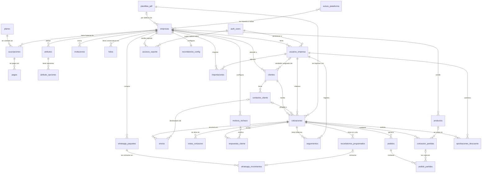

# Diagrama entidad-relación
Última actualización: 2026-10-15 · Fuente: mapa aprobado en P-018 (D-020) · Las relaciones marcadas ❓ se definen en el Paso 1c.

Notación: `||--o{` = uno a muchos (0 o más) · `||--||` = uno a uno · `|o--o{` = opcional (0 o 1) a muchos.
`auth_users` = usuarios de Supabase Auth (login). Solo se muestran llaves; los campos se definen tabla por tabla.

## Relaciones por confirmar (Paso 1c)
| # | Relación | Pregunta |
|---|---|---|
| P-020 | auth_users ↔ empresas | ¿Un usuario puede estar en varias empresas? |
| P-021 | contactos_cliente ↔ clientes | ¿Un contacto puede pertenecer a dos clientes? |
| P-022 | cotizaciones ↔ contactos_cliente | ¿A quién le llega la cotización? |
| P-024 | cotizaciones (versiones) | ¿Editar una enviada crea v2 o sobrescribe? |
| P-026 | cotizaciones ↔ pedidos | ¿Una cotización = un pedido? |
| P-028 | clientes ↔ vendedor | ¿Uno o varios vendedores por cliente? |
| P-032 | motivos_rechazo | ¿Fijos o configurables? |
